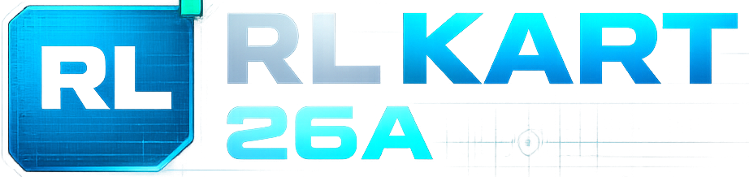
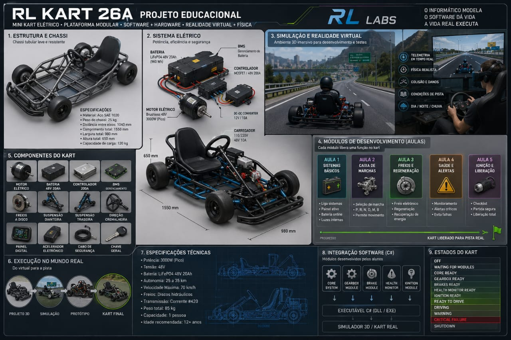
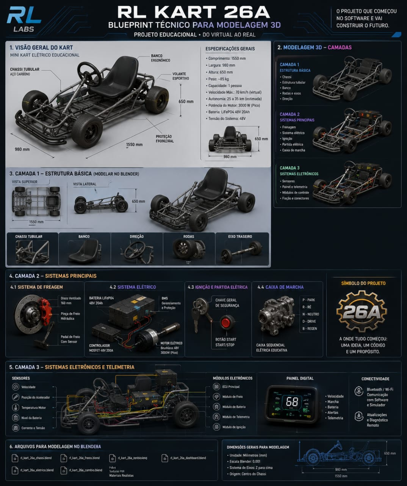

# RL Kart 26A

Plataforma educacional da **RLLabs** para engenharia de software aplicada a um
mini kart eletrico: arena 3D, oficina tecnica, telemetria, validacao de DLLs C#
e fluxo didatico de modulos.

<p align="center">
  
</p>

<p align="center">
  
  
  
  
  
  
</p>

## Thumbs

| Arena | Oficina | Blueprint |
|---|---|---|
|  |  |  |

## Visao Geral

O RL Kart 26A une simulacao 3D e ensino de programacao modular. A proposta e
permitir que alunos criem modulos em C#, compilem DLLs e validem contratos
tecnicos em uma oficina virtual antes de observar o comportamento do kart em uma
arena de corrida.

O projeto atual e um frontend/simulador com:

- home institucional do projeto;
- Arena de Corrida em Three.js/React Three Fiber;
- Oficina tecnica do kart com foco por modulo;
- importador e inspetor de DLLs C#;
- contrato documentado para alunos;
- telemetria, auditoria, HUDs, replay e paineis de engenharia;
- modo demo/mock para simular dados de modulos enquanto o host .NET real nao
  esta conectado.

## Rotas Principais

| Rota | Funcao |
|---|---|
| `/` | hub do projeto, arquitetura, aulas, stack e visao educacional |
| `/simulator` | Arena de Corrida full body com IA, replay, classificacao, grid e telemetria |
| `/simulador-real` | Oficina tecnica com kart, sala acustica, paineis C# e checklist |

## Experiencias

### Arena de Corrida

- Cena 3D full body.
- Rayssa como piloto principal.
- Modo Engenharia Observador.
- Progressao por vitorias.
- Classificacao alternada, grid oficial e largada.
- Pit lane simplificado.
- Replay, camera selector, split-screen e HUDs.
- Controles de debug, hitbox e performance.

### Oficina Tecnica

- Kart procedural/GLB fallback por partes.
- Foco por modulo: motor, freios, direcao, bateria, painel e chicote.
- Sala acustica com teste Wankel animado.
- Controle de volume seguro.
- Wireframe/X-Ray e labels tecnicos.
- Auditoria de telemetria.

### DLLs C#

O painel `DLLs C# · Importar & Testar` valida contratos estaticamente no
navegador:

- cabecalho PE;
- metadados .NET/BSJB;
- nome do arquivo por slot;
- `AssemblyName`;
- `ModuleId`;
- versao SemVer;
- funcoes obrigatorias por modulo.

Guia dos alunos:

- [`public/docs/DLL_STUDENT_GUIDE.md`](./public/docs/DLL_STUDENT_GUIDE.md)

Contrato tecnico:

- [`public/docs/CSHARP_MODULE_CONTRACT.md`](./public/docs/CSHARP_MODULE_CONTRACT.md)

Limite atual: o frontend inspeciona DLLs e executa cenarios simulados via
`mockBridge`. Para executar DLLs reais, ainda e necessario um host .NET externo
conectado por WebSocket.

## Arquitetura

```text
Aluno desenvolve DLL C#
        |
        v
Contrato de modulo
        |
        v
Inspector no navegador
        |
        v
Bridge mock ou WebSocket real
        |
        v
Telemetria / estado do kart
        |
        v
Oficina tecnica + Arena 3D
```

## Stack

| Camada | Tecnologia |
|---|---|
| App | React 19 + TypeScript |
| Roteamento/SSR | TanStack Start / TanStack Router |
| 3D | Three.js, React Three Fiber, Drei |
| UI | Tailwind CSS, componentes Radix/shadcn-style |
| Audio | Web Audio + assets locais |
| Modulos | C#/.NET, DLLs e contrato educacional |
| Deploy principal | build SSR/worker compativel com runtime server/edge |

## Estrutura Relevante

```text
src/
  components/
    simulator/       Arena, corrida, HUDs, replay, IA
    realsim/         Oficina tecnica, kart, sala acustica, DLL panel
    rl/              Home, secoes institucionais e stack
  routes/            Rotas TanStack Start
  bridge/            Mock/WebSocket telemetry bridge
  lib/csharp/        Inspector de DLLs
public/
  docs/              Contratos e guias de entrega
  models/            Modelos publicos quando disponiveis
  sounds/            Eventos e audio de corrida
```

## Executando Localmente

```bash
npm install
npm run dev
```

URL padrao:

```text
http://127.0.0.1:5173/
```

## Build

```bash
npm run build
```

Saida atual:

```text
dist/client  # assets publicos do cliente
dist/server  # bundle SSR/worker
```

Observacao de deploy: este projeto nao e uma SPA estatica pura. O build atual
nao gera `dist/client/index.html`; portanto, um `.htaccess` de Apache sozinho
nao e suficiente para rodar a aplicacao completa em hospedagem compartilhada
estatica. Para esse cenario, seria necessario adaptar o projeto para export
SPA/static dedicado. O alvo atual e um runtime SSR/worker/Node compativel.

## Checks Recomendados

```bash
npx eslint src/routes/__root.tsx src/routes/index.tsx src/components/rl/Stack.tsx src/components/simulator/SimulatorScene.tsx
npm run build
```

## Roadmap Tecnico

- Host .NET externo para execucao real das DLLs.
- WebSocket de telemetria em ambiente integrado.
- Export estatico opcional para hospedagem compartilhada.
- Capturas oficiais da Arena/Oficina para substituir thumbs locais.
- Testes automatizados para contratos de modulo.

## Redes

- YouTube: [@rubinholyralabs](https://www.youtube.com/@rubinholyralabs)
- Instagram: [@rubinholyralabs](https://www.instagram.com/rubinholyralabs/)
- LinkedIn: [Rubens Lyra](https://www.linkedin.com/in/rubenslyra/)
- TikTok: [@rubinholyra](https://www.tiktok.com/@rubinholyra)

## Autor

Rubens Lyra  
RLLabs

## Licenca

Projeto educacional experimental.
